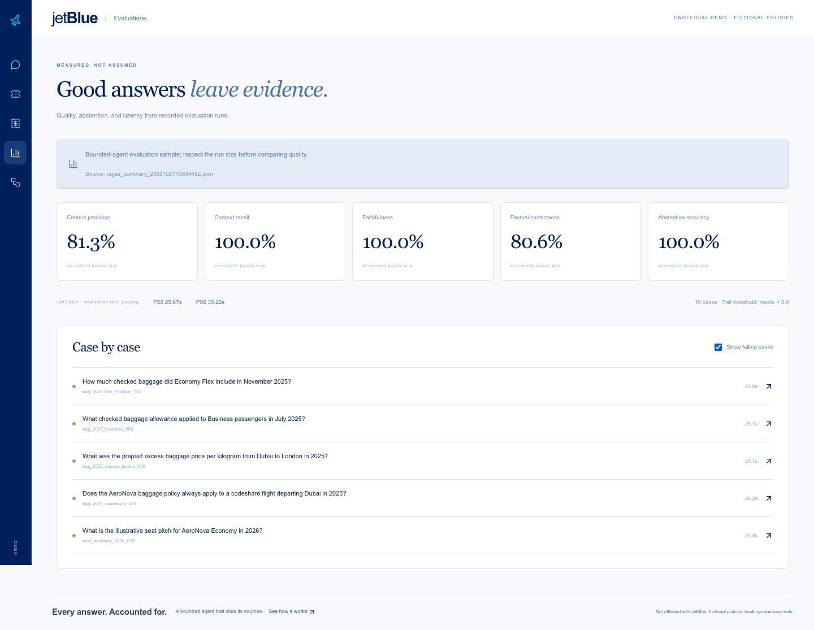
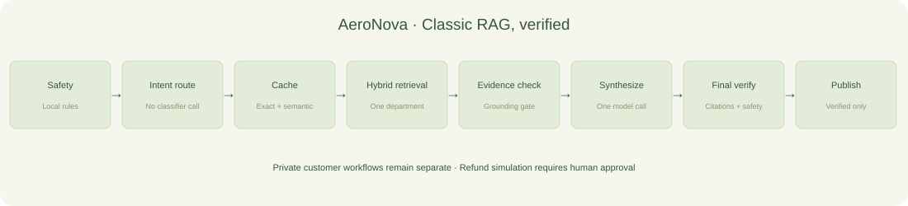

# AeroNova — bounded, verified airline assistance

A fictional-airline portfolio project with deterministic classic RAG, public
policy retrieval, customer-scoped demo tools, and a five-page Next.js workspace.
All airline policies, people, bookings, status snapshots and payment records are
invented. Refund processing is a local simulation; no money moves.



## Run locally

The verified lockfile and CI target Python 3.13, Node 22+, Docker and Tesseract OCR.
Use Python 3.13 for the commands below. The earlier
`.venv` points to a missing Anaconda interpreter on this machine; the verified
replacement environment is `.venv-agent`.

```sh
python3 -m venv .venv-agent
.venv-agent/bin/python -m pip install -c requirements.lock -e '.[dev,eval]'
cp .env.example .env  # only if you do not already have .env; fill in your own keys
# Never overwrite an existing .env containing credentials.
docker compose up -d vector-db redis
.venv-agent/bin/python -m context.indexers.build_index
AERONOVA_DEMO_CUSTOMER=CUST-1001 .venv-agent/bin/python -m uvicorn backend.app:app --host 127.0.0.1 --port 8000
```

In a second terminal:

```sh
cd web
npm ci
npm run dev
```

Open http://127.0.0.1:3000. For the CLI:

```sh
.venv-agent/bin/python -m agent.factory
.venv-agent/bin/python -m agent.factory --demo-refund-customer CUST-1001
```

The old `python answer.py`, `python build_index.py`, and retrieval entry points
remain available. `create_agent()` remains a supported composition function.

## Architecture



```text
agent/
  factory.py        resource construction + thin CLI
  answers.py        grounded schema, synthesis, compatibility validation functions
  cli.py            presentation and explicit /refund command adapter
  session.py        single source of truth for CLI, JSON API and SSE
  cascade.py        deterministic intent-to-department routing
  route_types.py    typed actions for authenticated workflows
  executor.py       bounded execution for authenticated workflows
  verifier.py       deterministic evidence and answer gates
  tools/            policy, flight, booking, claim and read-only calculation tools
  refund_agent.py   separately confirmed, idempotent refund simulation
backend/            API, SSE, CSRF, 10 requests/minute/IP, PDF and eval adapters
web/                Next.js App Router + Tailwind + Radix/shadcn-style primitives
context/            ingestion, hybrid indexing/retrieval and two-tier caches
safety/             deterministic redaction, intent policy and bounded retry utilities
tests/              offline unit, replay-golden, auth, safety, API and concurrency tests
evals/              optional paid RAGAS harness against the same ChatSession
```

An uncached public request uses deterministic safety checks and intent routing,
hybrid retrieval, one answer-generation call, and deterministic verification.
There is no LLM classifier or planner call in this path. Exact-cache hits skip
retrieval and synthesis; semantic-cache hits skip synthesis. Authenticated refund
approval remains a separate workflow.

Evidence is checked before synthesis. The response is checked after synthesis and
again at the final gate. Fabricated citations, unsupported measured quantities,
PII and unsafe output are rejected. Multiple department requests are clarified
instead of fanning out. These checks do not prove
semantic entailment; they complement, not replace, grounding evaluations.

Public policy answers cite chunk IDs. Public flight-tool facts get separate
`TOOL-n` source IDs and are labelled archived fictional snapshots. Private tool
facts are rendered deterministically and never sent to synthesis or public caches.
Customer identity and confirmation come from server-bound context. A demo
customer binding is **not production authentication**.

## Web pages

The frontend uses AeroNova branding. Its policy and customer data are fictional,
not real airline terms or booking records.
The current refunds corpus covers baggage claims; it contains no ticket-refund
policy for cancelled flights. Retrieving candidate chunks does not establish
that a question is answerable; refusals display no supporting citation chips.

- `/` and `/chat`: a full-height conversation, a compact navigation rail, and
  clickable examples. The trace drawer starts open on desktop and collapses after
  the first answer; phones and narrow laptops open it on demand. Grouped phases
  show elapsed times, the retrieval step and verification results. Numbered
  citations open the actual retrieved passage, with a sentence highlighted by word
  overlap as a reading aid. The footer reports citation/quantity checks, source
  count and latency; cache details remain in the trace. Cache hits show the actual
  original execution in a faded, dated section with its own historical timings.
  Historical traces store only operational public-policy metadata: no questions,
  arguments, model text or customer records. Older entries without recorded provenance are
  labelled as unavailable rather than reconstructed. Failed verification has a
  separate error panel with real check counts. These deterministic checks do not
  establish semantic entailment or a count of unsupported claims.
- `/bookings`: customer-scoped sample bookings, PDF confirmation downloads and
  archived flight lookup. Try AN201 on 2026-10-02 or AN202 on 2026-10-03.
- `/refunds`: checked claims, explicit confirmation and post-processing PDF receipts.
- `/evals`: recorded RAGAS metrics, abstention accuracy, failing cases, reference/
  response comparisons and latency percentiles. Historical scores are labelled;
  they are not represented as fresh scores for the new agent.
- `/architecture`: pipeline diagram and allowlisted links to implementation files.

`POST /api/chat/stream` uses fetch/ReadableStream SSE. The chat waiting state
follows route, lookup, synthesis and verification events with a pulsing skeleton.
The frontend ignores token events and waits for the final `result` before rendering
answer text. Released answers render as safe Markdown with a character reveal of
at most 0.5 seconds; reduced-motion users see the full answer immediately. The
complete released answer is available to screen readers without character-by-character
announcements, and its fixed layout keeps the user's bubble anchored above it.
Progress events arrive as steps run; **answer tokens are released only after verification**, rather than
exposing unverified model tokens. The backend emits a final result for safety,
cache, refusal and error paths too. A disconnect never authorizes a mutation.

The API binds private records only when `AERONOVA_DEMO_CUSTOMER` is configured.
Otherwise it runs in public mode. Mutations require the same-origin token from
`/api/overview`, checked Origin and explicit boolean confirmation. Requests are
limited to 10/minute/IP per process; trusted proxy configuration and distributed
rate storage are needed when scaling. Demo records are never publicly indexed.
The API must not be presented as a production-authenticated customer service.

## Safety, caching and logging

The local gate precedes caches and models: PII redaction/detection, prompt injection,
unsafe links and profanity handling. Profanity alone is a warning. General-policy
questions containing “my” are not automatically private. Heuristics are a bounded
first layer, not a universal safety classifier. Sensitive identifiers are resolved
only by dedicated local, customer-bound workflows or rejected before model egress.

JSON logging recursively redacts known identifiers and secret patterns and includes
`request_id`. Timings are structured `{step, ms, request_id}` records. Progress
traces contain no raw question or private tool data.

Exact keys contain normalized question, answer prompt hash, index fingerprint and
pipeline version. Semantic reuse additionally scopes department, policy year,
prompt version, corpus, model and day, preserves significant terms/route order,
and requires similarity >=0.97. It scans at most 100 Redis records: O(n) is
intentional here; use a Redis vector index/FT.SEARCH beyond ~1,000 entries.
Empty public retrieval results use a 300-second exact TTL. Normal public answers
use 24 hours. Private records and changing flight status never enter either cache.
Cached answers are reverified on read.

## Refund simulation

```text
/refund list
/refund check REF-DEMO-001
/refund proceed REF-DEMO-001 confirm
```

The dedicated CLI and HTTP confirmation route are the only processing paths; no
write/payment tool is exposed to public RAG. Approved amount, evidence, linked
case/booking ownership and original destination are checked deterministically.
SQLite transactions prevent duplicate simulation receipts, including concurrent
requests. Changed previously processed claims require review. The standalone agent
still works with `python -m agent.refund_agent --demo --customer-id CUST-1001 ...`.

## Verification and evaluations

```sh
.venv-agent/bin/python -m pytest -q
.venv-agent/bin/python -m ruff check .
.venv-agent/bin/python -m mypy agent
.venv-agent/bin/python -m pip check
cd web && npm run build && npm run typecheck
# With the API and web servers running, and Chrome installed:
npm run test
```

Offline replay fixtures test the full session, expected document IDs, abstention,
cache reuse and withholding unverified output without calling an LLM or RAGAS.
Authenticated workflow tests cover authorization, confirmation and deadlines.
Refund tests cover idempotency and scoping.
Browser tests use mocked SSE only for deterministic UI traces; booking, PDF,
refund, flight and recorded-evaluation endpoints are exercised against the API.
Browser refund tests may record an idempotent synthetic refund in the local ledger.

RAGAS remains optional/paid:

```sh
.venv-agent/bin/python evals/run_ragas_eval.py --limit 10
```

The evaluator uses ChatSession with caches disabled. The pinned RAGAS 0.4.3 +
langchain-community 0.3.31 environment imports all four metrics without placeholder
VertexAI modules; `evals/ragas_compat.py` has been removed. A 0.5 release was not
available when resolving this environment. `requirements.lock` freezes the tested
resolution; the core package does not require the evaluation extra.

CI runs lint, type checks, offline tests, dependency/import checks and the web
build. The paid RAGAS workflow runs manually, nightly, or on trusted same-repository
PRs explicitly labelled `run-ragas`. Configure secrets and an `evaluations`
environment before enabling it. It never runs with secrets on untrusted fork code.

## Deployment

Local containers:

```sh
docker compose -f docker-compose.yml -f docker-compose.agent.yml up --build api web
```

Rebuild the public index with the same corpus/environment before serving answers.
`render.yaml` defines the AeroNova API service on Render's Free plan. The Next.js
frontend is deployed separately at `https://aeronova-eight.vercel.app`. Phoenix
export is disabled for the Render API; local Phoenix data is not part of the
deployment. To connect the API:

1. Create a hosted Qdrant collection endpoint. In Render, select the GitHub
   repository and set the Blueprint path to `rag_airlines/render.yaml`; its
   `rootDir` points the service build at this project within the parent monorepo.
2. Supply `OPENAI_API_KEY`, `QDRANT_URL`, and `QDRANT_API_KEY` when Render prompts
   for the API service's unsynced environment values. Use the Qdrant provider's
   API key. Redis caching is optional and safely falls back when unavailable.
3. Build the public Qdrant index once against that remote Qdrant URL by running
   `python -m context.indexers.build_index` from this project with the same
   `QDRANT_URL` and `OPENAI_API_KEY`. The API checks `index_state.json` against
   the corpus and will not answer until the remote collection has been built.
4. The Blueprint sets API `PUBLIC_ORIGIN` to the Vercel site and `ALLOWED_HOSTS`
   to the planned API hostname. If Render assigns a different hostname, update
   both the API `ALLOWED_HOSTS` and Vercel `BACKEND_URL`, then redeploy.

The Blueprint uses Render's Docker runtime ports. `Dockerfile` and
`web/Dockerfile` honor the injected `PORT`. The API's demo refund records and
SQLite ledger are fictional and are not production account authentication or a
production-grade persistent claims system. Real identity, live operations and
payment adapters must be configured before any production customer usage. No
external deployment or real payment is performed by these setup instructions.

Optional OpenTelemetry export can be enabled with `AERONOVA_ENABLE_OTEL=1` after
installing the `tracing` extra and starting Phoenix. JSON logs and web trace events
work without it. No raw customer identifiers or route arguments are attached to
spans.

### Verified local evaluation (27 October 2026)

The capped 10-case bounded-agent run recorded faithfulness 1.000, context recall
1.000, abstention accuracy 1.000, context precision 0.813 and factual correctness
0.8056, with no citation, measurement or metric errors. It is a small sample with
a different case count from the older 17-case run, not a universal quality claim.
The saved run's latency includes evaluator judging and is labelled accordingly;
new evaluations separately record agent-only and evaluation latency. See
`evals/results/ragas_summary_20261027T063448Z.json`.

The lowest factual-correctness case in that sample illustrates judge noise: the
reference and response both specify the same illustrative seat pitch (79 cm), but
the metric returned 0. The recorded score is preserved rather than overwritten;
the dashboard's side-by-side evidence should be inspected before interpreting
metric changes as factual regressions.

Retrieval queries retain the original question's dates, fare, route order and
conditions. Live flight status is outside the public policy RAG path.

### Phoenix request traces

Install the optional tracing dependencies (`pip install -e '.[tracing]'`), start
Phoenix (`docker compose up -d phoenix`), and restart the API with
`AERONOVA_ENABLE_OTEL=1`. `PHOENIX_ENDPOINT` configures the HTTP collector;
`PHOENIX_PUBLIC_URL` is the browser-accessible base URL (default `http://localhost:6006`).
A one-second startup health probe and guarded registration disable tracing for the
process if Phoenix is unavailable; restart after bringing Phoenix back online.
Later export failures remain in the background batch exporter and do not block answers.

Each `aeronova.request` carries `request_id` and `aeronova.request_id`. Its children
include deterministic retrieval, `aeronova.synthesize`, and evidence/final verifier
spans with pass/failure counts. The public RAG path does not create planner or
parallel tool spans. Model/provider
spans and usage depend on installed OpenInference auto-instrumentors; this is not
a cost accounting system or a semantic entailment verifier. Auto-instrumentation
can capture prompts/responses: use synthetic demo data when sharing Phoenix views.

The trace footer shows **View in Phoenix** only for a recorded current request,
using Phoenix's [documented trace redirect](https://arize.com/docs/phoenix/tracing/how-to-tracing/advanced/constructing-urls).
Batch export may take a few seconds before the trace is visible. A cache hit links
to the current cache-hit request, not the historical ghost execution. Disabled
tracing produces neither a fake trace ID nor a dead default dashboard link.
For a portfolio screenshot, run a cache-miss policy question and capture the real
Phoenix trace alongside the assistant.

### LangGraph orchestration and human review

`agent/graph.py` is the request `StateGraph`, invoked by the shared CLI/API
`ChatSession.ask()`. Its nodes are safety → intent route → cache → hybrid retrieval
→ evidence check → synthesis → verification → publish. The public path is linear
and deterministic until answer synthesis. Generated text is released only after
verification. This does not add cross-turn conversational memory.

`agent/refund_graph.py` remains a separate graph: prepare → human_review (`interrupt`) →
process or reject. SQLite checkpoints in `.runtime/approvals.sqlite3` persist the
review across API restarts. The Refunds page creates a review, displays the amount,
and offers Confirm simulation, Reject simulation, or Not now. Resume review reloads
its server checkpoint; a browser refresh does not authorize processing. Approval
uses `Command(resume=...)`. Only the bound customer may read/resume a workflow;
claim, receipt and booking changes invalidate the reviewed fingerprint. The existing
refund ledger remains idempotent if an execution is retried. All records and payments
are synthetic. SQLite and the service lock target the single-worker local demo;
a multi-worker deployment needs a shared transactional checkpointer/operation lock.

API: `POST /api/refunds/{claim_id}/review`, `GET /api/refund-reviews/{workflow_id}`,
`POST /api/refund-reviews/{workflow_id}/decision` with `{"approved": true}` or false.
Mutations require the existing Origin and CSRF token; arbitrary graph-state updates
and client-provided customer identities are not accepted. The older confirmed
`/proceed` endpoint also traverses the graph. CLI: `/refund review CLAIM_ID`, then
`/refund approve WORKFLOW_ID confirm` or `/refund reject WORKFLOW_ID`.

Dependencies are pinned to LangGraph 0.6.11 with the SQLite checkpointer 2.0.11 to
retain this project's LangChain Core 0.3 compatibility. Install using the existing
locked setup command. Phoenix remains the optional tracing backend.

The new six-page fictional route-menu PDF can be downloaded from Architecture or
`/api/policies/route-menus.pdf`. Its reproducible source is
`scripts/build_route_menus.py`; indexed source is
`data/policies/CAT-CABIN-ROUTES-2026.pdf`. Rebuild after document changes with
`python -m context.indexers.build_index`. Index schema v5 adds directional route
metadata and the changed corpus hash invalidates older cached answers.
